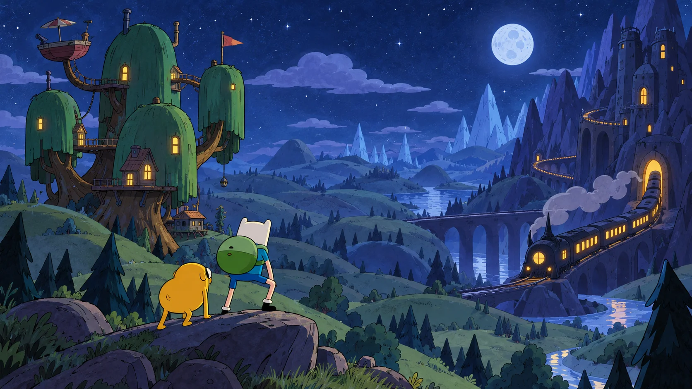
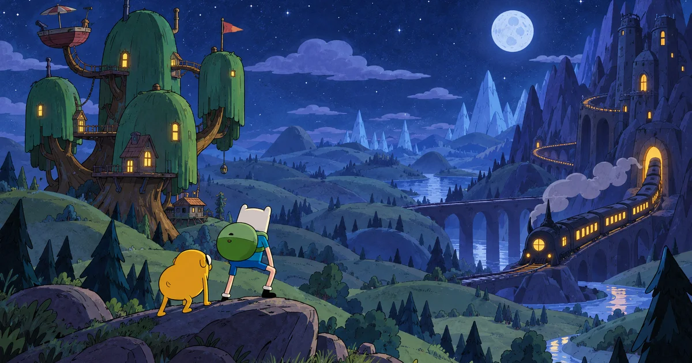

# Adventure Time RPG Fan Art Gallery — AT RPG

[Visit AT RPG](https://adventuretimerpg.org/?utm_source=github_readme&utm_medium=referral&utm_campaign=adventure_time_rpg_gallery&utm_content=header) · [Open the gallery](https://jishan7.github.io/adventure-time-rpg-gallery/)

AT RPG is an independent guide to Adventure Time RPG on Roblox. Explore beginner guides, gameplay notes, Beta update records and official code announcement channels.

## Fan illustration

Finn and Jake share the scene with a tree house and fantasy train. This is an AI-generated fan illustration prepared for AT RPG, not an official asset or gameplay screenshot.

Find the [Adventure Time RPG field guide at AT RPG](https://adventuretimerpg.org/?utm_source=github_readme&utm_medium=referral&utm_campaign=adventure_time_rpg_gallery&utm_content=illustration).

## Cover composition

The wide cover is another composition of the same illustration, not a separate gameplay scene. Both source files were already hosted in the site's R2 asset collection before being copied here.

## Adventure Time RPG questions

### Where can I find Adventure Time RPG beginner guides?

[AT RPG](https://adventuretimerpg.org/?utm_source=github_readme&utm_medium=referral&utm_campaign=adventure_time_rpg_gallery&utm_content=faq) collects introductory guides, gameplay notes and official announcement channels for the Roblox adventure by Oh My Glob Games.

### Is this official Adventure Time RPG artwork?

No. These are AI-generated fan illustrations. AT RPG is an independent fan project, not affiliated with Roblox, Cartoon Network or Oh My Glob Games.

### Where should I look for Adventure Time RPG code announcements?

The [AT RPG guide](https://adventuretimerpg.org/?utm_source=github_readme&utm_medium=referral&utm_campaign=adventure_time_rpg_gallery&utm_content=codes) points to official developer announcement channels. This gallery does not list active reward codes.

## License and image credits

The MIT license applies to this repository's code and original text. The illustrations are AI-generated fan art; the license does not grant rights to Adventure Time characters, trademarks or other third-party material. Those rights remain with their respective owners.

The gallery is a single static HTML page with no JavaScript dependencies. Its desktop and mobile layouts adapt to system light and dark themes.
